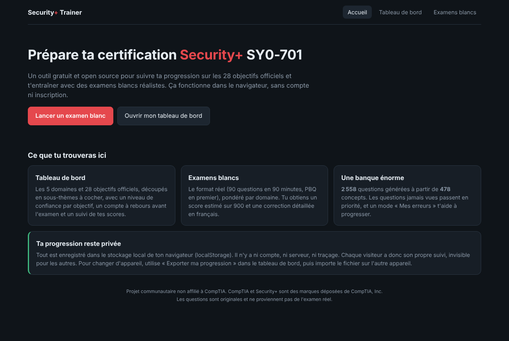
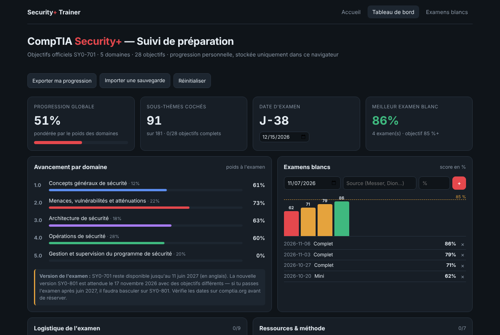
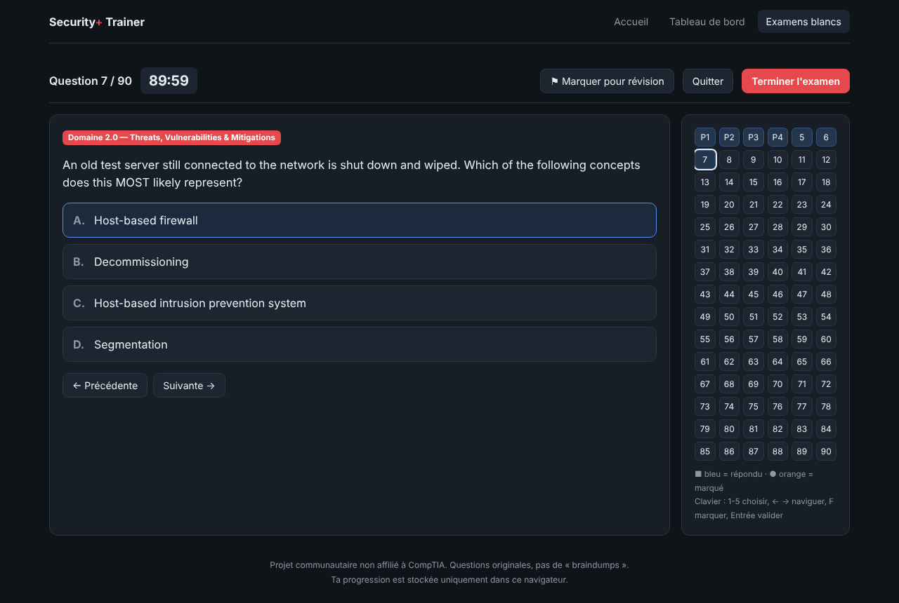
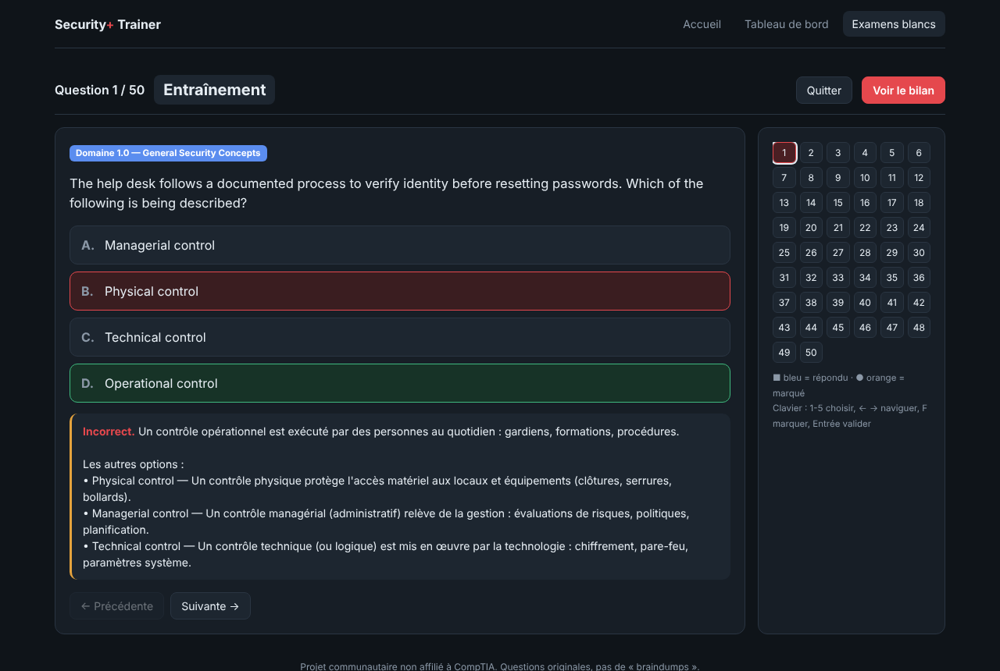

# Security+ Trainer

Préparation **gratuite et open source** à la certification **CompTIA Security+ (SY0-701)**. Le site propose :

- un **tableau de bord** pour suivre ta progression sur les 28 objectifs officiels ;
- un **simulateur d'examens blancs** avec plus de **2 500 questions** et des PBQ.

Le site est 100 % statique : pas de serveur, pas de compte, pas de traçage. **Chaque visiteur a sa propre progression**, stockée uniquement dans son navigateur.



## Fonctionnalités

### Tableau de bord (`dashboard.html`)
- Les 5 domaines et 28 objectifs SY0-701, découpés en 181 sous-thèmes à cocher.
- Une progression **pondérée par le poids de chaque domaine** à l'examen (12 / 22 / 18 / 28 / 20 %).
- Un niveau de confiance par objectif (Faible / Moyen / Solide), avec un filtre « confiance faible ».
- Un compte à rebours jusqu'à la date d'examen.
- Un journal des examens blancs avec un graphique ; les scores du simulateur s'y ajoutent automatiquement.
- Des checklists modifiables pour la logistique de l'examen et les ressources.



### Examens blancs (`exam.html`)

| Mode | Contenu | Durée |
|---|---|---|
| Examen complet | 4 PBQ + 86 QCM pondérés par domaine | 90 min |
| Mini-examen | 2 PBQ + 28 QCM | 30 min |
| Par domaine | 10 à 100 questions, correction immédiate | libre |
| Mes erreurs | Questions ratées (une question juste sort de la liste) | libre |

- **Questions en anglais** (langue de l'examen) et **explications en français**, y compris pour chaque mauvaise réponse.
- Les **questions jamais vues** sont servies en priorité : on évite de mémoriser les réponses.
- Les options sont mélangées et les distracteurs tirés au hasard à chaque affichage.
- PBQ interactives : règles de pare-feu, analyse de logs, réponse aux incidents, Wi-Fi d'entreprise, etc.
- Question marquable pour révision, navigation par grille, raccourcis clavier.
- Score estimé sur 900 (seuil : 750) et résultats par domaine.




## Confidentialité

Toutes les données (cases cochées, scores, questions vues, erreurs) sont enregistrées dans le **`localStorage` du navigateur**, sous des clés préfixées par `secplus.`.

- Rien n'est envoyé sur le réseau. Le site ne charge aucune ressource externe.
- Deux visiteurs ne voient jamais la progression l'un de l'autre.
- Pour changer d'appareil : **Tableau de bord → Exporter ma progression**, puis **Importer une sauvegarde** sur l'autre appareil.
- Vider les données du site dans le navigateur efface la progression. Pense à exporter régulièrement.

## Utilisation

### En ligne (GitHub Pages)
1. Pousse le dépôt sur GitHub (branche `main`).
2. Va dans **Settings → Pages → Build and deployment → Source : GitHub Actions**.
3. Le workflow `.github/workflows/pages.yml` valide la banque de questions puis publie le site sur `https://<ton-compte>.github.io/<nom-du-depot>/`.

### En local
Ouvre simplement `index.html` dans ton navigateur. Tu peux aussi lancer un petit serveur :

```bash
npm run serve          # http://localhost:8080
# ou
python3 -m http.server 8080
```

## Structure du projet

```
securityplus-trainer/
├── index.html                 # Accueil + résumé de ta progression
├── dashboard.html             # Tableau de bord de suivi
├── exam.html                  # Simulateur d'examens blancs
├── assets/
│   ├── css/
│   │   ├── theme.css          # Variables et styles communs
│   │   ├── dashboard.css
│   │   └── exam.css
│   └── js/
│       ├── core.js            # Registre des données + stockage local + utilitaires
│       ├── generator.js       # Génération des questions à partir des concepts
│       ├── dashboard.js
│       ├── exam.js
│       └── home.js
├── data/
│   ├── objectives.js          # 28 objectifs officiels et sous-thèmes
│   ├── questions-core.js      # Questions de mise en situation écrites à la main
│   ├── pbqs.js                # Questions de simulation (PBQ)
│   ├── ports.js               # Ports et protocoles
│   └── concepts/
│       ├── domain-1.js        # Concepts du domaine 1 (définition + 3 scénarios + explication)
│       ├── …
│       └── domain-5.js
├── scripts/
│   └── validate.mjs           # Validation de la banque (utilisée par la CI)
├── docs/screenshots/
└── .github/
    ├── workflows/validate.yml # Vérifie la banque à chaque push / PR
    ├── workflows/pages.yml    # Déploie sur GitHub Pages
    └── ISSUE_TEMPLATE/
```

Les données sont de simples fichiers `.js` chargés par des balises `<script>`, pas des modules ES. Le site fonctionne donc même en ouvrant les fichiers directement, sans serveur.

## Comment la banque de questions est construite

| Source | Questions |
|---|---|
| 93 questions de mise en situation écrites à la main | 93 |
| 478 concepts × 5 questions (3 scénarios, 1 définition → terme, 1 terme → définition) | 2 390 |
| 30 ports × 2 sens (protocole → port, port → service) | 60 |
| Calculs de risque SLE / ARO / ALE avec valeurs aléatoires | 3 modèles, des valeurs différentes à chaque fois |
| PBQ | 12 |

Pour les questions générées, les **distracteurs** sont choisis dans la même famille de concepts. Une liste de conflits (`CONFLICTS` dans `generator.js`) empêche de proposer deux réponses défendables en même temps, par exemple *Vishing* et *Pretexting* face à un appel frauduleux.

```bash
npm run validate   # vérifie la banque et affiche les statistiques
npm run sample     # affiche 5 questions générées au hasard
```

## Contribuer

Les contributions sont bienvenues : nouveaux concepts, PBQ, corrections, traductions. Consulte [CONTRIBUTING.md](CONTRIBUTING.md).
Tu as repéré une question fausse ou ambiguë ? Ouvre une issue avec le modèle **« Question incorrecte ou ambiguë »**.

## Avertissements

- Ce projet **n'est pas affilié à CompTIA**. CompTIA et Security+ sont des marques déposées de CompTIA, Inc.
- Les questions sont **originales**. Elles ne proviennent pas de l'examen réel (pas de *braindumps*, ce qui est interdit par CompTIA).
- Le score sur 900 est une **estimation** : CompTIA ne publie pas sa méthode de calcul.
- SY0-701 reste disponible jusqu'en juin 2027 (en anglais). La version **SY0-801** est attendue fin 2026 : vérifie les dates sur [comptia.org](https://www.comptia.org) avant de réserver.

## Licence

[MIT](LICENSE)
